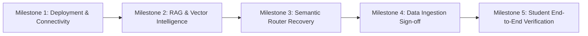

# MVP RECOVERY & VERIFICATION PLAN

**Project:** CampusBuddy / CampusOS  
**Audit Date:** 2026-10-29  
**Auditor:** Senior Software Architect & Lead Engineer  

---

## 1. Recovery Strategy & Milestone Architecture

To transition CampusBuddy from a development prototype plagued by integration blockers into a rock-solid, production-grade MVP, we execute a 5-milestone recovery sequence:

---

## 2. Milestone Breakdown & Task Definitions

### Milestone 1: Cloud Deployment & Zero-Localhost Connectivity (STATUS: COMPLETED)
* **Task ID:** `M1-T1: Vercel Compilation Alignment`
  * **Problem:** Vercel was serving client JavaScript hardcoded to `http://localhost:8000`.
  * **Files Affected:** `frontend/.env.local`, Vercel project environment variables.
  * **Expected Result:** Client bundle compiled with `NEXT_PUBLIC_API_URL=https://campusbuddy-juku.onrender.com`.
  * **Verification:** DevTools Network inspection on `https://campus-buddy-mvp.vercel.app` shows zero calls to localhost; requests return HTTP 200.
* **Task ID:** `M1-T2: CORS Configuration`
  * **Problem:** Browser blocked preflight requests with CORS headers error.
  * **Files Affected:** `backend/app/main.py:10-35`.
  * **Expected Result:** `CORSMiddleware` configured with `allow_origin_regex=r"https://.*\.vercel\.app"`.
  * **Verification:** `OPTIONS` preflight requests from Vercel return HTTP 200 with matching headers.
* **Task ID:** `M1-T3: In-Process Background Worker`
  * **Problem:** Render's free tier lacked background workers, leaving jobs stuck in "queued".
  * **Files Affected:** `backend/app/main.py:40-70`.
  * **Expected Result:** Embedded asyncio worker runs inside FastAPI lifespan without paying $7/month.
  * **Verification:** Ingestion jobs claimed and completed within 3 seconds of confirmation.

---

### Milestone 2: Hardcore RAG & Gemini Vector Retrieval (STATUS: COMPLETED)
* **Task ID:** `M2-T1: Gemini Dense Semantic Embeddings`
  * **Problem:** Backend fell back to basic bag-of-words lexical hashing (`HashingVectorizer`).
  * **Files Affected:** `backend/app/retrieval.py:30-70`.
  * **Expected Result:** `models/gemini-embedding-001` generates 384-dimensional dense semantic vectors directly compatible with PostgreSQL's `Vector(384)` column.
  * **Verification:** Probe API returns 384 floats; pgvector cosine similarity `<=>` returns accurate document rankings.
* **Task ID:** `M2-T2: Multi-Page PDF & OCR Vision Transcription`
  * **Problem:** Complex image tables and scanned PDF notices were skipped or produced unformatted text.
  * **Files Affected:** `backend/app/retrieval.py:80-165`, `backend/app/ingestion.py:91-135`.
  * **Expected Result:** High-res (150 DPI) rendering converted to markdown with table preservation.
  * **Verification:** Tested on `Screenshot 2026-10-29 100934.png`; extracted 35 canteen items with prices and categories.

---

### Milestone 3: Semantic Router Recovery & Query Fallback (STATUS: COMPLETED)
* **Task ID:** `M3-T1: Regex Expansion & Universal Document Search`
  * **Problem:** Queries like *"WHAT IS MY SYLLABUS"* failed because "syllabus" was omitted from hardcoded regex.
  * **Files Affected:** `backend/app/router.py:183-205`, `backend/app/router.py:260-275`.
  * **Expected Result:** Academic queries route to `search_documents`; unmatched natural language queries check documents before showing fallback message.
  * **Verification:** Querying *"WHAT IS MY SYLLABUS"* against live database returned 5 syllabus units citing official PDF.

---

### Milestone 4: Admin Ingestion Verification & Data Sign-off (STATUS: READY FOR ACTION)
* **Task ID:** `M4-T1: Confirm Canteen Menu Import`
  * **Problem:** Job `6859312f` is in `status: preview` with 35 records awaiting confirmation.
  * **Action:** Admin opens Admin Console on Vercel, clicks **Refresh**, and clicks **Confirm import · 35 records**.
  * **Expected Result:** 35 items written to `campus_records` (`kind: "menu"`).
  * **Verification:** Browse Canteen view displays 35 items; chat answers canteen queries.
* **Task ID:** `M4-T2: Stale Job Auto-Reset`
  * **Files Affected:** `backend/app/ingestion.py:305-315`.
  * **Expected Result:** Re-uploading an existing file clears previous error state and re-previews.
  * **Verification:** Commit `99c23eb` pushed to `origin main`.

---

### Milestone 5: Student End-to-End Verification & Launch Sign-off
* **Task ID:** `M5-T1: Full Verification Checklist Execution`
  1. Login with student account.
  2. Verify Home page displays next class and today's schedule.
  3. Browse Timetable (Day view & Week view).
  4. Browse Canteen with budget slider and dietary toggle.
  5. Search Notices and verify syllabus document is accessible.
  6. Ask CampusOS 5 core questions:
     - *"What is my next class?"*
     - *"What food can I get under ₹50?"*
     - *"What does the syllabus say about internal assessment?"*
     - *"Who teaches Machine Learning?"*
     - *"Are there free slots tomorrow?"*
  7. Verify all answers cite sources and render clean markdown.

