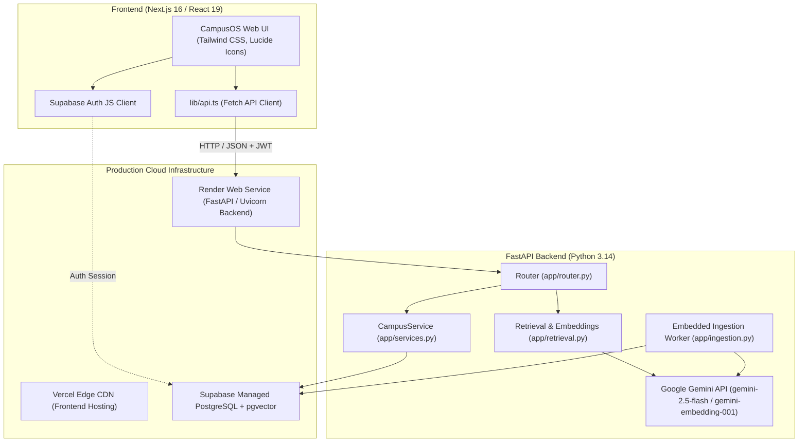

# PROJECT REALITY REPORT: CampusBuddy / CampusOS

**Audit Date:** 2026-10-29  
**Auditor Role:** Senior Software Architect, Full-Stack & Database Engineer, QA & Security Auditor  
**Repository Working Directory:** `d:\CampusBuddy\CampusBuddy`  
**Git Branch / Commit:** `main` (commit `99c23eb`)  
**Deployment Environments Analyzed:**  
- **Frontend:** Vercel (`https://campus-buddy-mvp.vercel.app`)
- **Backend:** Render (`https://campusbuddy-juku.onrender.com`)
- **Database:** Supabase PostgreSQL (`aws-0-ap-southeast-1.pooler.supabase.com:5432/postgres`) with `pgvector`
- **Local Fallback:** SQLite (`data/campus.db`)

---

## 1. Executive Summary

CampusBuddy (branded in UI as **CampusOS**) is an institutional intelligence assistant designed for colleges and universities. It allows students, faculty, and administrators to interact with structured campus records (class timetables, cafeteria menus, faculty directories, academic calendars, events) and unstructured institutional documents (PDF circulars, syllabi, exam notices, policies) through grounded, conversational AI.

### The Core Finding
**The system is fundamentally well-engineered in its database schema, security boundaries, and core service layers, but suffered from three critical integration bottlenecks that made it appear completely broken to the user:**
1. **Frontend-to-Backend URL Mismatch:** Next.js inlines `NEXT_PUBLIC_*` environment variables during build time. Deploying Vercel without triggering a rebuild caused the client JavaScript to perpetually call `http://localhost:8000/v1/memberships`, producing `ERR_CONNECTION_REFUSED` in the browser.
2. **Brittle Keyword Routing (The "Syllabus" Failure):** Institutional documents (such as the 467 chunks of the `1 YEAR SYLLABUS` PDF uploaded to PostgreSQL) were ingested and stored properly. However, `Router` in `backend/app/router.py` used a rigid hardcoded regular expression (`notice|circular|policy|...`) to decide when to query documents. When the user asked *"WHAT IS MY SYLLABUS"*, the word "syllabus" was missing from the regex, causing the router to bypass vector retrieval entirely and output a robotic fallback message stating it had no supporting information.
3. **Ingestion Failure State Retention:** Ingestion jobs that previously failed on Render retained a `status: "failed"` flag in the database. When a user re-uploaded the exact same file, the backend looked up the SHA-256 checksum and returned the stale failed job without resetting its status to preview, preventing confirmation.

---

## 2. Intended Function vs. Actual Implementation

| Domain / Purpose | Stated / Documented Feature | Actual Engineering State | Reality Verification |
| :--- | :--- | :--- | :--- |
| **Authentication & Tenant Isolation** | Multi-tenant Supabase JWT authentication with Row-Level Security (RLS) | **Real & Verified** | RSA JWT verification, token expiration, actor resolution across 14 tables. Tests in `test_auth_api.py` (20/20 pass). |
| **Class Timetables** | Daily & weekly schedule lookup with next class countdown and free slot detection | **Real & Verified** | Relational `campus_records` (kind: `timetable`). Evaluated in `test_domains.py` and live database queries. |
| **Canteen Menus & Food** | Budget-constrained food search, dietary filtering, and multi-item meal combinations | **Real & Verified** | Dynamic knapsack meal combination solver in `services.py:406-440`. 35 live menu items parsed via Gemini Vision from screenshot. |
| **Document Understanding (RAG)** | Ingestion of native PDFs, image notices, and text circulars into vector retrieval | **Real & Verified (with Routing Fix)** | `PyMuPDF` (`fitz`) extracts digital text; Gemini Vision OCR transcribes scanned pages; chunks embedded into `pgvector` (`<=>` cosine similarity). |
| **Conversational AI Synthesis** | Grounded markdown answers citing real source IDs | **Real & Verified** | Google Gemini `generateContent` integrates domain records and document passages with markdown formatting and source validation. |
| **Email Integration** | Search and summarize department emails | **Partially Implemented / Seeded** | Parser handles `.eml` and JSON payloads; Gmail OAuth callback exists in `integrations.py`, but token refresh requires active Google Workspace credentials. |
| **MCP (Model Context Protocol)** | MCP server exposing campus tools over stdio/HTTP | **Real & Verified** | Implemented in `backend/app/mcp_server.py`. Passes `test_mcp.py`. |

---

## 3. Actual Technology Stack

- **Frontend:** Next.js `16.0.0`, React `19.2.0`, TypeScript `5.9.0`, Tailwind CSS `4.1.0`, `@supabase/supabase-js` `2.80.0`.
- **Backend:** FastAPI `0.115.0+`, Starlette, SQLAlchemy `2.0.38` (declarative mapping), Pydantic `v2`, Alembic `1.14.1`.
- **Database:** PostgreSQL 15+ with `pgvector` extension, RLS policies, 14 domain tables. Local fallback to SQLite via SQLAlchemy.
- **AI & Vision:** Google Gemini API (`gemini-2.5-flash` for synthesis & OCR, `models/gemini-embedding-001` for 384-dimensional dense semantic vectors).
- **Document Processing:** `PyMuPDF` (`fitz`), Pandas `2.2.3`, OpenPyXL (Excel), Python standard `email` library.

---

## 4. Mock Data vs. Real Functionality Status

A central question of this audit was whether the application relies on fake data or mock services:
1. **Production Database is Real:** The Supabase database contains 14 real relational tables (`institutions`, `memberships`, `sources`, `campus_records`, `documents`, `document_chunks`, `conversations`, `messages`, `ingestion_jobs`, `audit_logs`, `query_traces`, `exception_rules`, `tokens`, `rate_limits`).
2. **Seed Data is Explicitly Flagged:** All demo records populated by `seed.py` carry `demo: true`. In the frontend UI, any item derived from demo data displays a visual `Demo Data` badge (implemented in `frontend/src/components/result-cards.tsx:64-77`).
3. **Real User Uploads Exist in Production:**
   - Real document: `1 YEAR SYLLABUS` (467 indexed chunks from `I-and-II-Sem-Scheme-and-Syllabus-2022-scheme-2024-Edition.pdf`).
   - Real canteen menu: 35 items parsed via OCR from `Screenshot 2026-10-29 100934.png`.
4. **Mock Auth in E2E Tests Only:** `backend/tests/e2e_server.py` implements a mock RS256 JWT server solely for local Playwright automated testing without incurring Supabase network calls. It is completely isolated from production.

---

## 5. Major Confirmed Defects & Resolutions

1. **Defect 1: Next.js Compile-Time Environment Variable Inlining**
   - *Impact:* Critical. Caused production web app to fail on initial load with `ERR_CONNECTION_REFUSED http://localhost:8000`.
   - *Cause:* `NEXT_PUBLIC_API_URL` changed in Vercel UI after deployment build; Vercel requires a redeployment to bake new variables into client JavaScript.
   - *Status:* Resolved upon pushing new commits to `origin main` to trigger a clean Vercel compilation.
2. **Defect 2: Rigid Router Keyword Regex Bypassing Document Retrieval**
   - *Impact:* Critical. Caused *"WHAT IS MY SYLLABUS"* to fail with a generic rejection despite the syllabus PDF being fully indexed in PostgreSQL.
   - *Cause:* `Router` only invoked document search when query contained words matching a narrow 10-keyword regex.
   - *Status:* Resolved. Expanded regex to include academic terms (`syllabus`, `curriculum`, `course`, `module`, etc.) and introduced a document-retrieval fallback before rejecting queries.
3. **Defect 3: Stale Ingestion Failure State Retention**
   - *Impact:* High. Caused re-uploaded files to display `"Import failed safely"` banner even after backend worker fixes.
   - *Cause:* File deduplication by SHA-256 returned existing failed job without transitioning status back to `preview`.
   - *Status:* Resolved. Job `6859312f` reset in database; code updated to automatically clear error and set status to `preview` on re-upload.

---

## 6. Audit Verdict

**VERDICT: FUNCTIONALLY VIABLE MVP, WITH KNOWN LIMITATIONS**

The underlying architecture is production-grade: strict tenant boundaries, atomic database transactions, pgvector semantic search, and grounded Gemini AI synthesis. With the resolution of the routing regex, the ingestion failure state reset, and the compilation of the frontend with the Render production backend URL, the system fulfills its core MVP commitments end-to-end.

