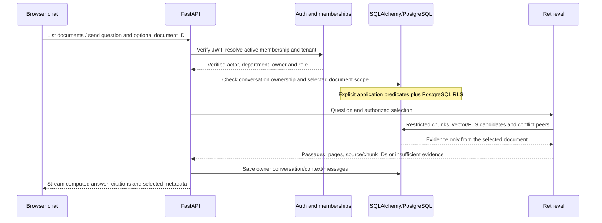

# CampusOS engineering walkthrough: Phases 3–6B and pre-Phase-7 corrections

> Historical phase notes: current setup/schema is **0009**. The mandatory second-reviewer requirement was superseded by scoped explicit same-admin approval in 0009. Original-machine revision/status statements and artifact links below are historical, not the state of a teammate checkout. See [current setup](../README.md), [publication](publication.md), [verification](verification.md) and [limitations](limitations.md).

## Pre-Phase-7: file evidence, verified identities and usable workflows

See [the issue-by-issue corrective report](verification.md) for causes,
changed functions, actual verification, limits, migrations and manual demonstrations.
Earlier phase sections below describe their historical implementation state.
Current code requires migration `0007`; the original SQLite is still `0005`, and
neither `0006` nor `0007` has been applied to it in this corrective pass.

### Real preview is different from indexing or publication

`main.source_content_preview` checks current source-management permissions, active
file state and the original checksum before invoking the bounded parser in
`preview_only` mode. It returns non-cacheable raster pages, sheet tables or escaped
text. It does not require a searchable document or create a publication. A scanned
original can be previewed even with OCR disabled; confirmation/extraction stays
blocked until configured. Office macros/external links, executable HTML and arbitrary
embedded document viewers are not used. PPTX thumbnails and exact Word layout are
explicitly unavailable; supported text, headings and tables remain readable.

`Ingestion.preview` now checks `schema_matches` before offering structured mappings.
A project roster is not a timetable because the user selected that menu item.
General official documents keep their original headers, values and relationships.
Authorized fixed scope remains metadata, not a guess about an unrelated column.
Administrators edit structured cells and validate changes before confirmation;
raw JSON/mapping diagnostics are available through progressive disclosure. Grouped
validation errors explain repeated failures without flooding the screen.

### Reusable row evidence and verified student numbers

`document_rows.units` preserves each workbook row with sheet/logical page/row number,
raw values and normalized student identifiers. Explicit team/scope keys and shared
identifiers connect membership, project and mentor sheets. Team numbers alone or
USNs mentioned in descriptions do not grant access. Unknown student identifier
formats in personal tables fail closed. Explicit mentor-name fields are distinguished
from mentor notes or email fields; these are not silently converted into assignments.

The same `DocumentChunk` table stores `row_data` and `student_numbers`; no table is
invented for each workbook format. Text chunks still serve normal documents, and
384-dimensional E5/pgvector retrieval remains. Re-indexing retains reviewed row
audiences and extracted text. The original file/checksum remains unchanged.

Membership `student_number` is optional, unique within the institution and assigned
through College Admin authority. It is not a self-service preference or a JWT claim.
`Actor.scope_key` includes that binding so saved personal answers are invalidated
when it changes. Personal mentor queries use that verified number before vector
ranking; a number typed in chat cannot establish identity or override another owner.
Missing mapping is an actionable refusal, not a name guess.

`main.conversation_history` also rechecks the current row permission on every cited
chunk of a saved shared student-record answer, including compound sections. A
published parent source is insufficient. Legacy answers without traceable chunk IDs
and answers whose row audience was removed are hidden without deleting stored data.

`CampusService.scope(DocumentChunk)` applies publication, tenant, owner, department,
semester/section and row audience **before** retrieval. PostgreSQL's
`campus_student_chunk` adds the same row restriction under the API role. Existing
private-user ownership is never overridden by admin status. Student-record source
originals remain administrator-restricted even when a student can read their own
team row. Citations show sheet/row and exact-match provenance, rather than treating
an identifier lookup score as semantic confidence. Normal public document and faculty
questions continue to use authorized structured or hybrid retrieval.

### Speech and mixed requests stay bounded and reviewable

`speech.infer` applies local Silero VAD, duration/energy bounds and then forced
language decoding. Explicit selections force English/Hindi/Kannada. Auto compares
only those three decodes; it never calls unrestricted `language=None` detection.
Quality gates reject weak, repetitive, unsupported-script or ambiguous results.
Equivalent transcripts may agree despite punctuation differences. Model scores are
not calibrated language probabilities. Transcripts remain editable before sending.
No new model download, paid API or external audio upload was added.

`speech-text.normalizeSpeechText` transforms only synthesis input. Clock expressions,
prices, ISO dates, known numeric date formats, abbreviations and citations become
speech-friendly text. Unknown date order is not guessed; Speech options lets the
user choose DMY/MDY. Local device voice availability is separate from text normalization
and human naturalness. No human Hindi/Kannada/code-switching or audible quality
acceptance is claimed from synthetic clips or decoder mocks.

`router.split_question` retains each supported intent, including punctuation-adjacent
`also`, exams and holidays. Each part gets its own answer and evidence; food cannot
overwrite timetable results. Sweet filtering uses explicit menu categories, not a
guess about ingredients or birthday suitability. `parse_date` understands named
month/day dates; `language.normalize` resolves relative `kal` from context or asks
for clarification. Availability checks use campus-local time, actual timetable
coverage, classes, exams/personal commitments and holidays. Missing coverage is
unknown, never proof that the student is free. Localization preserves the reason.

### File actions and migration safety

`ConfirmationDialog` uses the browser's modal layer plus explicit Tab cycling,
Escape cancellation and focus restoration. File/review controls are centered over
the current viewport. Actions retain the selected source ID; purge still requires
the full typed ID. Lists distinguish upload IDs, scope, file state, publication
history, versions and replacements. No historical files are merged or removed
automatically. Server authorization, audits and publication semantics remain intact.

Migration `0007_document_identity.py` adds only identity/evidence fields, constraints,
an index and PostgreSQL policies/helpers. Legacy shared spreadsheet chunks are
conservatively restricted until a new row-aware version is reviewed and published;
ordinary re-indexing does not invent an audience. Data is retained for authorized
administrators. Review this availability change before migration approval.
Consistent backups/disposable migration tests do not authorize changing the original.
The separate-process demo and regression harness use fresh scratch resources.

## Phase 6B: connected campus workflows

The existing FastAPI/SQLAlchemy services, durable worker, Next.js interface,
Supabase identity verification and independent publication workflow remain in
place. [Product acceptance](PRODUCT_ACCEPTANCE.md) contains the five-role matrix,
executable scenarios, actual results, local demonstration and deployment gates.
The machine-derived evidence is [phase6b-verification.json](../artifacts/phase6b-verification.json).
The original development database remains `0005`; `0006` is verified on disposable
copies and PostgreSQL, and has not been approved/applied to that original.

### Code map and reasons for the changes

| Files | Responsibility and change |
| --- | --- |
| `backend/app/auth.py`, `schemas.py`, `models.py` | Exactly five roles; bounded department/semester/section scope; calendar and exam inputs |
| `backend/migrations/versions/0006_product_scopes.py` | Add source/document/record scope, role constraints, scoped PostgreSQL RLS and lifecycle checks without resetting data |
| `backend/app/db.py` | Refuse old SQLite before startup writes; reserve SQLite writes before query-trace autoflush |
| `backend/app/ingestion.py`, `duplicates.py` | Validate scoped rows, stage results, check checksums/keys/date overlaps in worker and require explicit replacement |
| `backend/app/publication.py`, `files.py` | Refresh roles, check current duplicate results and replacement scope; preserve review/revoke/delete/restore boundaries |
| `backend/app/services.py` | Scope every read, apply calendar closures, retain teaching assignments, sanitize published-menu management |
| `backend/app/main.py` | Calendar API, sanitized menu editing, scope-preserving re-index, membership cache invalidation |
| `backend/app/router.py`, `tools.py`, `language.py` | Calendar SQL, exam/date routing, latest-circular retrieval, bounded notice summaries and vocabulary |
| `backend/app/semantic.py`, `retrieval.py`, `config.py` | Offline E5 provider, compatible model IDs, hybrid ranking and lexical fallback |
| `backend/app/cache.py` | Reuse authorized shared views; bypass private data; reauthorize hits and invalidate after commit |
| `backend/app/seed.py` | Single Campus Canteen in new synthetic fixtures; existing records untouched |
| `frontend/src/components/admin-view.tsx` | Role/scope controls, calendar/exam workflows, duplicate review and validated-menu editing |
| `frontend/src/components/campus-app.tsx`, `browse-view.tsx`, `result-cards.tsx`, `frontend/src/lib/api.ts` | Role-aware navigation, academic dates/cards, typed scope/duplicate responses |
| `backend/tests/test_product_*.py`, `test_cache.py`, `test_postgres.py` | Full workflows, denial paths, migration preservation, real Redis/pgvector/RLS |
| `backend/tests/e2e_server.py`, `process_support.py`, `frontend/tests/product.spec.ts`, existing browser helpers | Fresh migrated synthetic fixtures, separate worker, per-viewport identities, three new product flows |
| `scripts/setup_semantic.py`, `evaluate_semantic.py`, `run_product_demo.py`, `report_phase6b.py` | Explicit approved assets, real multilingual measurement, isolated demo and generated evidence |
| `backend/requirements-semantic.txt`, `.env.example`, `config/staging/*env.example` | Optional runtime and explicit matching API/worker embedding configuration |

These are Phase 6B responsibilities, not a claim that every pre-existing working
tree change belongs to this phase. Earlier phases below explain their own files.

### Upload to published answer

1. FastAPI verifies the JWT and resolves an active membership. An uploaded role or
   tenant ID never grants authority. `Actor.check_department_write` checks kind,
   department, semester and section. College-wide is a deliberate scope, not an
   escape value for a Department/Section Admin.
2. `Ingestion.receive` stores the private original and a **draft** Source. Parsing
   produces an editable mapping/row preview; validation checks dates, required
   fields, row scope and faculty references. Images/scanned pages retain the
   existing OCR review gate. Receiving or previewing does not publish anything.
3. Confirmation persists a queued job. `work_once` claims it durably, rechecks the
   uploader's current permissions, parses/chunks or validates all rows and runs
   `duplicate_report`. Structured rows remain staged. Shared documents may have
   stored chunks, but parent publication checks make them inaccessible to students.
4. Successful processing leaves the shared source `pending_review`. Duplicate
   results appear in preview/review. Checks include exact bytes, natural keys,
   effective timetable overlaps, exam/date scope, calendar periods and optional
   logical keys. Document titles/topics produce warnings rather than invented
   semantic equality. Checks are bounded at 2,000 sources/10,000 rows; incomplete
   checks block publication instead of pretending a full comparison succeeded.
5. `Publication.transition` refreshes the caller and independently verifies the
   uploader/reviewer, successful job, current state, scope and duplicates. Approval
   cannot be self-approval. Only College Admin can approve structured originals;
   another scoped admin can review authorized documents. Approval and publication
   are separate actions. PostgreSQL repeats the restrictions in locked lifecycle
   functions; the API role has no general permission to promote source status.
6. Publish activates staged records and completes replacement in one transaction.
   The previous source stays published throughout preview, processing and review.
   A failed transaction keeps that valid version; a successful replacement marks
   it replaced. Revocation cancels unfinished jobs. Restore returns shared files
   to review rather than silently republishing them. Private user-owned ingestion
   remains owner-only and does not enter institutional review.
7. Commit updates the tenant's cache revision. Subsequent reads reauthorize the
   published source and its rows; original-file authorization is checked separately.

This distinction matters: SQL can filter a mixed-department spreadsheet's rows,
but downloading that spreadsheet would reveal its other rows and unmapped columns.
Students never receive that raw structured original. A manager editing another
admin's menu receives only validated public menu fields through
`canteen_sources`/`canteen_edit_rows`, and a replacement still needs independent
approval. `CampusService.canteen_source` rejects legacy department-restricted menus.

### Student question to answer

`auth.verify_token` validates asymmetric signature, issuer, audience, expiry and
subject. `resolve_actor` reads the active membership, rather than trusting JWT role
claims. `db.set_identity` supplies transaction-local PostgreSQL RLS context. The
shared `CampusService.scope` adds tenant, private owner, department, semester,
section, file state and published-parent predicates before retrieval or cache use.
RLS independently enforces those bounds for a restricted API database login.
The worker/migration owner is trusted infrastructure and requires separate credentials.

`Router.ask` normalizes bounded campus vocabulary and uses deterministic tools for
clear requests. The tool catalog now has fifteen read-only operations including
`get_academic_calendar`. Multi-part requests share a bounded call budget. A
selected document forces retrieval to that authorized document; failure does not
broaden the search. Follow-ups preserve selection and current-access checks.

| Example | Route and evidence |
| --- | --- |
| What's my next class? | Effective section timetable + date exceptions + published calendar closures |
| Is today a college holiday? | Academic calendar SQL; no entry means no supporting calendar evidence |
| When is my next exam? | Future examination events + relevant circular conflicts |
| Is there an exam tomorrow, and what time does it begin? | Date-bounded exam SQL, stored start/end and venue |
| What does the latest examination circular say? | Authorized date-eligible notice metadata, then retrieval restricted to newest matching document |
| What can I eat for under ₹100? | Available menu rows + deterministic numeric price filter |
| Who teaches Operating Systems to my section? | Effective timetable assignment joined to published faculty, even on a holiday |
| Summarize today's important campus notices | Today's authorized notices + bounded per-document evidence snippets |
| Professor research interests/biography | Authorized document retrieval; missing named professor does not expand to a department guess |
| Next class and food under ₹100 | Bounded multi-part SQL tools and separately cited results |

The calendar does not invent institution closures: holiday entries cancel classes
by default, or can explicitly set `classes_cancelled=false`. Exams are validated
events, with `subject`, date/start/end and venue normalized to existing event
fields. Calendar entries use `title`, `start_on`, optional `end_on`, `entry_kind`
(`holiday`, `academic`, `important_date`) and optional scope. Existing timetable
schemas and exception behavior remain. Notice summaries without generation are
labelled evidence excerpts, not model-written explanations.

### PDF extraction, structured SQL and semantic retrieval

The existing bounded `parsing.py` readers extract PDF text/tables in subprocesses.
Scans use local OCR only when configured; extracted rows still need validation and
editable review. Structured data goes into validated `campus_records.payload`
with indexed tenant/kind/provenance/scope columns. SQL handles dates, prices and
section relationships; embeddings are not used for timetable arithmetic.

Document chunks preserve document/source IDs and pages. `semantic.LocalE5`
loads approved local ONNX/tokenizer files, verifies their manifest hashes, adds
`query:`/`passage:` prefixes, applies attention-masked mean pooling and normalizes
384-dimensional vectors. Inference is CPU-local, bounded in batches/concurrency,
and never downloads assets. See the official
[E5 model card](https://huggingface.co/intfloat/multilingual-e5-small) and
[quantized ONNX distribution](https://huggingface.co/Xenova/multilingual-e5-small/tree/main/onnx).
The approved download was 129.1 MiB into ignored `.scratch/semantic-e5`.

`Retrieval.search` constructs the authorized document/chunk query first.
PostgreSQL combines compatible-model pgvector cosine candidates with full-text
candidates, then reranks using semantic and lexical scores. Semantic scoring uses
65% threshold-adjusted cosine and 35% lexical similarity; `SEMANTIC_MIN_SCORE=0.78`
is an evaluation setting, not a probability. SQLite bounds its candidate scan.
Embeddings carry a content-fingerprinted model identity; vectors from different
weights/preprocessing are never compared. Older/incompatible documents remain
lexically searchable. Missing/model failures fall back to lexical retrieval.
Selected-document filtering also constrains conflict expansion and citations.

The eighteen-question real evaluation in `scripts.evaluate_semantic` passed its
small local gate: actual retrieval top-1 was 100% English, 83.3% Hindi and 83.3%
Kannada. Staging templates prefer `EMBEDDING_PROVIDER=onnx` with explicit
`EMBEDDING_MODEL_PATH=/app/assets/semantic-e5`; existing `.env` was untouched.
Use identical assets in API/worker, then intentionally re-index authorized existing
documents. Dimensions remain 384, so no vector-dimension migration is needed.
Rollback can choose lexical mode without deleting original text. Broader campus
quality and deployment resource measurements remain acceptance work.

Optional generation still uses existing adapters and policy gates, disabled in
the local fixture. Evidence includes chunk IDs/pages/source metadata. Citation
IDs, exact quotes and supported numbers are checked; bad/provider-failed output
falls back to extracts. These checks establish traceability, not full factual
entailment or universal prompt-injection resistance.

### Cache, migration and operations

`SharedCache` shares public results between users with the same authorized view;
the key retains tenant, role, department, semester, section, query and source
revision/fingerprint. This conservative partition protects legacy mixed files.
Timetable/date-exception results stay user-specific. A private-result probe bypasses
caching before limits can hide private rows. Every hit rechecks authorized record
and source IDs. Original-download button permissions are recalculated for each
caller because two managers can share public menu data but have different raw-file
rights. Publication, replacement, deletion, restore and membership writes
invalidate only after commit; rolled-back writes do not publish an epoch. Redis
outages return normal SQL results, including on PostgreSQL. JWTs, private emails
and document chunks are not cached. Redis remains optional; Phase 6 measured no
benefit at small local fixture scale, so this phase makes no latency improvement claim.

Migration `0006` adds scope and role restrictions and refreshes PostgreSQL helpers,
RLS and safe replacement checks. SQLite uses explicit constraint triggers without
rebuilding parent tables; PostgreSQL uses constraints/policies/functions. Legacy
faculty becomes Student and platform admin becomes College Admin; unknown or
unbounded admin roles require operator review. Disposable backups prove preservation
of the original's existing values, plus intentional scope backfill. The production
API role cannot bypass RLS; a database owner/worker remains a trusted boundary.

See [acceptance and exact commands](PRODUCT_ACCEPTANCE.md) before running the new
application. Startup refuses the old SQLite schema before `create_all` writes.
The synthetic demo uses fresh migrated scratch resources and a separate worker,
so it runs without migrating the original or using Supabase credentials. Hosted
Auth/Storage, restricted-login/pooler and worker acceptance still require approval.

## Phase 6: real local OCR, voice and bounded performance

See the [Phase 6 engineering walkthrough](phase6.md) for the image-to-reviewed-SQL
and speech-to-grounded-answer flows, provider choices, cache authorization and
invalidation, worker concurrency, streaming limits, actual benchmarks, installation,
manual demonstrations and engineering questions. The
[executed verification report](verification.md) distinguishes real local
integrations from mocks and lists remaining acceptance gates. Earlier phase
sections below describe their historical implementation state.

## Phase 5: ingestion and file management

The existing FastAPI/SQLAlchemy worker and independent publication workflow are
extended, not replaced. `parsing.py` runs bounded format-specific readers in
short-lived subprocesses. PDF tables, Office XML, spreadsheets and text feed the
same Pydantic validation and editable mapping/row preview. OCR is opt-in and
requires local engine/language data; no OCR/model installation or external AI
processing was performed.

`files.py` adds authorized soft deletion, restoration as draft, reviewed rollback
and explicitly confirmed permanent deletion. Shared sources remain unpublished
until processing, independent approval and publication succeed. A durable
`purge_pending` tombstone hides a file before object deletion; cleanup failure is
visible and requires an explicit retry. Chunks, embeddings, structured rows and
source-dependent saved answers are removed or redacted. Minimal audit metadata
and a purged source tombstone remain. Existing private-owner boundaries apply.

Migration `0005` adds `sources.file_state` and PostgreSQL lifecycle enforcement.
After disposable verification and separate approval, the original development
SQLite was consistently backed up and upgraded from `0004` to `0005` on November 2.
All pre-existing values in 13 application tables were preserved; all 19 sources
received `file_state=active`. See `artifacts/development-migration-0005.json`.
No live service or Docker resource was changed. Phase 3/4 results below are historical.

See [the Phase 5 walkthrough](phase5.md) for exact functions, upload/publication
flow, indexing and deletion semantics, failure recovery, limitations, local demo
commands and senior-engineer/CEO interview questions. Executed results are in
`artifacts/phase5-verification.json` once final verification finishes.

Phase 3's historical results are retained below. For Phase 4 implementation,
configuration, evaluation and demonstration, see [the Phase 4 walkthrough](phase4.md).
Live Supabase and model-provider integrations still require separately approved
staging verification; passing local contract tests does not complete those checks.

## Phase 4 implementation overview

The existing fourteen tools, membership checks, publication lifecycle, hybrid
retrieval and selected-document isolation remain. `Router.ask` now normalizes
common campus language, splits up to four recognizable requests and shares one
eight-call tool budget. Clear questions use SQL or document rules; uncertain
campus requests may use a constrained advisory plan. There is no LangGraph runtime.
Faculty teaching assignments come from the student's effective section timetable.
Current/next class interpretation uses the institution's campus timezone.

`ai.py` now provides explicitly configured Gemini, OpenRouter and loopback Ollama
adapters. Providers default to disabled. Raw questions are treated as potentially
private; external chat requires an approved private-data policy reference. Models
receive no JWT, role authority or database connection. Each generated claim must
cite a retrieved chunk with an exact quote and supported numbers; this establishes
traceability rather than full factual entailment. Provider failures retain
authorized extractive answers.

The chat language selector persists English/Kannada/Hindi/automatic preference.
Without a model, common vocabulary and fixed labels work; records and excerpts
stay in their original language. This is bounded language support, not universal
translation. Multi-part cards and generated explanations keep evidence visible.

See [Phase 4](phase4.md) for the exact code map, request flow, SQL/RAG examples,
provider settings, privacy boundaries, performance budgets, manual demonstrations
and interview questions. See [executed Phase 4 verification](verification.md)
for counts, earlier failures, preservation checks and pending live acceptance.

## 1. Starting point and current status

Before Phase 3, CampusOS already had Next.js, FastAPI, verified Supabase JWTs,
active institution memberships, SQLAlchemy, SQLite development and PostgreSQL/RLS,
private originals, a persistent ingestion worker, deterministic domain tools,
hybrid document retrieval and optional Gemini synthesis. Phase 1 separated
processing from independent approval/publication. Phase 2 local verification
found and fixed publication grants, signing-key caching and durable queue
acknowledgement. The original development database was separately approved and
upgraded to `0004` before this work.

The missing feature was document selection: chat searched across its authorized
corpus, and conflict expansion could add other authorized documents. There were
no selection input, selection-restoration API or chat selector.

Phase 3 adds that complete local workflow and prepares staging configuration and
acceptance probes. **Phase 3 is not marked fully complete:** actual Supabase
Auth/Storage and hosted worker acceptance remain unverified and require explicit
staging approval. No live credentials or cloud resources were used during this
implementation. Current executed counts and the original-database preservation
check are recorded in `artifacts/phase3-verification.json`.

Final local results: **189 backend tests passed**, including 14 PostgreSQL checks;
**24 browser tests passed** across desktop, tablet and mobile. There were zero
final failures, errors, flaky cases or skipped tests. Ruff, TypeScript, production
build and diff checks passed. The smaller runs overlap the full suite and must
not be added together. Original SQLite bytes, schema and all rows still match the
approved `0004` snapshot. No new migration was applied.

## 2. Files, responsibilities and database changes

| File | Exact functions/types | Change and purpose |
| --- | --- | --- |
| `backend/app/schemas.py` | `ChatRequest`, `DocumentSelectionUpdate` | Typed optional chat selection; explicit selection update/clear payload |
| `backend/app/services.py` | `document_query`, `selected_document`, `document_metadata`, `selectable_documents` | Shared publication/owner/tenant/department/expiry-aware document access and bounded listing |
| `backend/app/main.py` | `selectable_documents`, `conversation_selection`, `change_conversation_selection`, `answer_chat`, `conversation_history` | REST list, restore/persist selection, chat context control and historical answer reauthorization |
| `backend/app/tools.py` | `DocumentInput`, `ToolKit.call` | Optional `document_id` reaches the same retrieval service through REST/MCP tools |
| `backend/app/retrieval.py` | `Retrieval.search` | Selection is applied before vector, keyword, SQLite ranking and conflict expansion; explicit insufficient evidence |
| `backend/app/router.py` | `Router.ask` | Selected mode takes precedence over general routing; bounded question-only follow-up context and page/chunk citations |
| `backend/app/ai.py` | `GeminiProvider.synthesize` | Supplies existing optional adapter with chunk/document/page/title metadata; existing source-ID validation remains |
| `frontend/src/lib/api.ts` | `SelectableDocument`, `DocumentSelection`, `DocumentPage`, `Citation`, `ApiError`, `streamChat` | Typed selector/restoration/citation payloads and recoverable HTTP status |
| `frontend/src/components/chat-view.tsx` | `ChatView`, `changeSelection`, `ask`, `open` | Authorized paginated selector, immediate selection persistence, restore, error states and title/page citations |
| `frontend/src/app/globals.css` | `.document-selector`, `.document-scope` | Wrapping, accessible layout for narrow screens and long titles |
| `backend/tests/test_selected_documents.py` | PDF isolation, scope/lifecycle, conversation and HTTP tests | Similar PDFs, page citations, ownership, clearing, switching, empty evidence and historical metadata |
| `backend/tests/test_postgres.py` | `test_rls_selected_document_limits_vector_keyword_and_conflict_queries` | Actual restricted-role PostgreSQL path and revocation |
| `backend/tests/test_staging_probe.py` | Plan/approval/project guards and mocked probe contracts | Prevent accidental cloud/credential use; verify probe behavior without live services |
| `backend/tests/conftest.py` | `running_api` | One shared ASGI/MCP lifetime across API test modules |
| `backend/tests/e2e_server.py` | `run` | Two synthetic, independently approved PDF fixtures, in disposable local storage/database |
| `frontend/tests/campus.spec.ts` | Selected-document workflow and recovery tests | Selection, follow-ups, refresh/reopen, switching, clearing, pages, empty/error/unavailable states on three widths |
| `scripts/verify_databases.py` | `sqlite_verify` | Supports read-only backup verification for originals already at `0004`, as well as `0003` |
| `scripts/staging_probe.py` | `main`, `approved_config`, `auth_probe`, `storage_probe`, `api_probe`, `membership_probe` | Plan-first, explicitly gated operator acceptance tools |
| `config/staging/` | Separate API, worker, frontend and probe templates/runbook | Keeps personal development/production configuration intact |

**No migration, new table, column, RLS policy or grant is required.** Selection and
its question-only context use the existing owner-scoped `Conversation.context`
JSON column on both SQLite and PostgreSQL. The schema remains at `0004`. The
original development database is used only through read-only backup/verification
connections during this task. Test writes occur in disposable databases.

## 3. Endpoints and payload semantics

| Endpoint | Behavior |
| --- | --- |
| `GET /v1/documents?limit=100&offset=0` | Authorized published, unexpired metadata only; returns `documents` and `next_offset` |
| `GET /v1/conversations/{id}/selection` | Owner-only current selection, rechecked for current access |
| `PATCH /v1/conversations/{id}/selection` | Owner-only validation and immediate durable switch/clear; resets old document context when changed |
| `POST /v1/chat` and `/v1/chat/stream` | Optional `document_id`; uses existing auth/membership and answer persistence |
| `POST /v1/tools/search_documents` | Same validated selection and retrieval implementation; MCP exposes the same typed field |

Chat distinguishes three inputs:

```json
{"question":"When is it?","conversation_id":"..."}
```

Omitting `document_id` retains the server conversation selection. A concrete ID
requests a switch and is reauthorized. Explicit null clears it:

```json
{"question":"My next class","conversation_id":"...","document_id":null}
```

The PATCH endpoint requires the field explicitly, including null for clearing.
This lets choosing/clearing survive reopening the conversation even before the
next question. It commits before returning success. The browser also sends its
current selection explicitly with every chat request. Neither that value nor a
tool-supplied ID grants permission.

An unavailable selected ID returns the same 404 message for absent, deleted,
revoked, unpublished or unauthorized documents. It does not silently broaden the
search. Restoration returns `{document: null, unavailable: true}` without a title
or ID when the prior selection is unavailable. The user must choose another
document or clear selection to resume. General chat stays available with no
selection.

## 4. Complete browser-to-answer flow



`auth.verify_token` checks the signature using the configured issuer's JWKS,
fixed issuer/audience, required claims, expiry and UUID subject. `resolve_actor`
loads the active database membership and establishes transaction-local identity.
The tenant header chooses a membership; browser or model role metadata does not
grant access. Question text is never executed as SQL/Python/shell instructions.

`answer_chat` checks conversation ownership before reading context. It discards
context when membership department/semester/section/role changes. It resolves
selection according to the three-state input, validates it through the service,
and clears the previous question/domain context when documents change.

`Router.ask` sends selected questions directly to `search_documents`. This means
“What is the timetable policy?” inside a selected handbook searches that handbook;
it does not accidentally run the timetable tool because the text contains a
structured keyword. With no document selected, the existing deterministic
timetable/menu/faculty/calendar/general document routing is preserved.

Streaming sends the computed grounded answer in SSE fragments and saves the
conversation; it is not token-by-token model reasoning. The frontend preserves
the selected title, displays each answer's own document title, and renders
page-aware source buttons. Request generations and aborts guard against stale
responses after scope changes or conversation navigation.

## 5. Authorization and RLS

`CampusService.scope(Document)` combines tenant, department, private ownership,
matching parent ownership and a published source. `document_query` additionally
applies default expiry filtering. This remains stricter than administrator review
access: an administrator cannot use student selection to retrieve unpublished
sources or somebody else's private document.

`selected_document` is called before embeddings or candidate ranking. A known ID
is simply a lookup key. Its predicates are parameterized SQLAlchemy expressions,
not generated SQL. `Retrieval.search` narrows both the visible-document query and
the chunk query to the selected ID. The same narrowed queries feed PostgreSQL
vector candidates, full-text candidates, SQLite candidates, metadata and conflict
peers. There is no “search everything and discard unauthorized hits afterward”
step and no global result cache.

PostgreSQL RLS remains enabled under `campus_api`; transaction-local identity comes
from the verified backend actor. Existing source/record/document/chunk policies
remain unchanged. The server database credential is trusted and must not be
exposed; RLS is ineffective against an API login that owns tables or bypasses it.
Local PostgreSQL tests use the restricted role, but actual staging login/pooler
configuration still needs live acceptance.

History is protected too. `conversation_history` rechecks both selected document
access and source access before returning an assistant message. This matters
even for an insufficient-evidence answer with no citations: its saved selected
title is still protected metadata. Private conversations remain owner-only.

Storage is a separate boundary: object URLs are not protected by document-table
RLS. Existing `ObjectStore.download` authorizes the source before privileged reads.
The private bucket and direct user/anonymous denials must be independently
verified in staging. No public/signed download URL or original-file policy bypass
was added. See the [staging runbook](../config/staging/README.md).

## 6. Extraction, retrieval and citations

Ingestion continues to use PyMuPDF text extraction, page-preserving chunks, the
persistent worker and Phase 1 approval/publication. Phase 3 does not add OCR or
timetable PDF table ingestion. Shared PDF processing remains hidden until a
different administrator approves and an authorized administrator publishes it.

Embeddings remain 384-dimensional. Default lexical hashing is not semantic
embedding. PostgreSQL takes bounded cosine and full-text candidates, followed by
TF-IDF/cosine reranking; SQLite ranks its authorized candidate corpus locally.
Selected lexical-mode hits additionally require actual lexical overlap rather
than accepting a hash collision alone. Scores rank evidence; they do not prove
that a passage entails every requested fact.

Hits retain chunk `id`, `document_id`, stable `source_id`, title, page, original
filename and version metadata. Responses group source citations with titles,
page numbers and retrieved chunk IDs. Source/document IDs remain stable for their
stored version; reindexing may replace chunk IDs. Citation buttons download only
through the existing permission-checked source endpoint.

Selected conflict expansion cannot append another document, even if it has the
same topic and a different recorded claim. General retrieval still surfaces those
authorized cross-document conflicts. A selection intentionally narrows the
evidence; it does not promise to expose contradictions elsewhere.

An empty corpus or no relevant selected hit returns an explicit insufficient-
evidence answer and empty sources, rather than searching a different document or
inventing an answer. Optional Gemini receives only retrieved authorized evidence
with chunk/page/title metadata. Its existing validated source-ID output and
extractive fallback remain. This does not establish sentence-level factual truth
or prove the live provider is configured; no live generation was tested here.

## 7. Follow-ups, switching and clearing

Only the chosen document ID and a bounded previous question are kept for selected
follow-ups. Brief anaphoric questions such as “When is it?” can combine that
question with the prior question to find the same subject. Retrieved passages
are not put into reusable conversation context or fed back from another document.
The original question is capped by existing input limits and never becomes an
authorization scope.

Switching or clearing selection resets that context. Clearing returns subsequent
questions to the general router, so “My next class” uses SQL again. PATCH saves
the change immediately; chat also supports omitted/ID/null semantics for API
clients. Every follow-up and reopen rechecks current permissions and publication.

Revocation cannot erase bytes already displayed/downloaded while permitted.
Read authorization is checked during requests; it is not a mechanism for remotely
erasing a browser's memory. A subsequent request/history read is denied or hides
the unavailable answer. Deployment/session/cache behavior still needs staging
acceptance. No offline cache of private passages was added; existing responsive
layout/PWA assets remain, with new controls tested at three widths.

## 8. Alternatives and trade-offs

- **SQL filtering versus post-filtering:** narrowing before top-k retrieval
  prevents both exposure and unrelated candidates consuming the search budget.
- **Document ID versus original source ID:** the selected unit is the indexed
  document; citations separately retain original-source provenance and download
  authorization. A source ID alone is not a valid selected-document ID.
- **JSON context versus schema migration:** existing owner-scoped JSON stores the
  small selection/anchor state without altering SQLite or PostgreSQL schemas.
  Pydantic and server lookup validation are still required on every input.
- **Explicit null versus one nullable default:** omission can retain context,
  while null reliably clears it. The browser is explicit; API clients can omit.
- **Native selector versus another UI library:** native controls reuse accessible
  styles, keyboard behavior and small-screen patterns. Pagination is bounded to
  100 items/request and offset 10,000; very large corpora need a future cursor or
  server-side selector search rather than an unbounded payload.
- **Stored question versus prior answer text:** a small question anchor helps
  follow-ups without carrying stale passages across selections. Ambiguous natural
  language and entailment remain retrieval-quality limitations.

## 9. Verification and a safe manual demonstration

Run from the inner repository. These commands use read-only original backup
verification, disposable PostgreSQL and fresh browser databases. They never
upgrade the original or use staging credentials:

```powershell
Set-Location <repository>
.\.venv\Scripts\python.exe -m scripts.verify_databases --postgres
.\.venv\Scripts\python.exe -m ruff check backend scripts
.\.venv\Scripts\python.exe -m scripts.verify_frontend
.\.venv\Scripts\python.exe -m scripts.staging_probe --check storage
git diff --check
```

The full backend suite includes Phase 1 security, existing domain routing,
selected PDFs, cross-user/department/tenant denial, draft/approved/revoked/replaced/
deleted documents, empty chunks, missing evidence, page citations, selection
restoration/changes, history reauthorization, and actual PostgreSQL RLS. Browser
tests cover selection/follow-ups/reopen/switch/clear and list/error/empty/unavailable
recovery at 390, 768 and 1440 pixels. Staging probes are tested with mocked HTTP;
their default plan mode reads no credentials and opens no network client.

Initial full-run issues are retained in `artifacts/phase3-*-initial.*`: the shared
MCP session manager was accidentally started twice through an imported API fixture
(186 passed, 3 setup errors); moving `running_api` to session-wide conftest fixed
it. Three browser recovery checks matched Next's route announcer as well as the
app alert (21 passed, 3 failed); narrowing the alert locator fixed them. These
were test-harness defects, not a reason to weaken publication/authorization. Final
counts and any subsequent failure history are in the Phase 3 report.

An additional mocked staging role-guard check initially supplied 404 for an
anonymous API request where the probe requires FastAPI's 401. Correcting that
mock let the check reach and verify the intended guard: a student mislabeled as
the administrator account is rejected, rather than recorded as admin-denial
evidence. This was a local mock contract check, not a provider test.

For a manual **local synthetic** demo, choose unused ports; if occupied, change
them rather than stopping another application's service. Terminal 1, repository
root:

```powershell
$env:CAMPUS_TEST_FRONTEND_PORT='43111'
$env:CAMPUS_TEST_API_PORT='43112'
$env:CAMPUS_TEST_AUTH_PORT='43113'
$env:CAMPUS_TEST_DIRECTORY='' # fixture creates its own fresh .scratch directory
.\.venv\Scripts\python.exe -m backend.tests.e2e_server
```

Terminal 2, `frontend/`:

```powershell
$env:NEXT_PUBLIC_API_URL='http://127.0.0.1:43112'
$env:NEXT_PUBLIC_SUPABASE_URL='http://127.0.0.1:43113'
$env:NEXT_PUBLIC_SUPABASE_PUBLISHABLE_KEY='test-only-publishable-key'
npm.cmd run dev -- --port 43111
```

Open `http://127.0.0.1:43111`, sign in as `student@example.invalid` with the fixture
password `CampusTest123!` (synthetic test identity only; never deploy this server).

1. Open **Ask CampusOS → Search a document → Selection Handbook Alpha**.
2. Ask **Zirconium scholarship deadline**: expect Friday, title Alpha and page 2.
3. Ask **Tell me more about that**: selection and evidence remain Alpha.
4. Refresh, reopen that conversation: expect Alpha restored.
5. Switch to **Selection Handbook Beta**: expect Tuesday, with no Alpha passages.
6. Ask **xylophonicquasarunrecorded**: expect explicit insufficient evidence and
   no citations, with no search of another document.
7. Clear selection, reopen it if desired, then ask **My next class**: expect
   the general timetable SQL path.

These fixtures independently process/approve/publish two real synthetic PDFs and
store their data only under `.scratch`. Stop only those two terminal processes
when finished. Use the automated denial tests for private/cross-scope cases rather
than editing the original development data. Real staging instructions, flags,
credential requirements, rotation and hosted-worker procedures are in
[`config/staging/README.md`](../config/staging/README.md).

## 10. Five senior-engineer questions

**1. Can a student guess another document's ID or ask the model to switch scope?**
No permission comes from an ID. The verified actor, active membership, service
scope, parent publication and PostgreSQL policies govern the lookup before any
candidate retrieval. Tool and browser input pass through the same validation.
The synthesis model receives evidence; it does not select an actor or tenant.

**2. Does a vector query or conflict expansion undermine that isolation?**
Both vector and keyword candidate SQL derive from the selected, authorized base.
Conflict peers use the same narrowed document query. The similar-PDF tests give
two documents overlapping text and conflicting claims, then verify only the
chosen document's IDs/pages/text appear. General mode retains cross-document
conflicts intentionally.

**3. Why isn't database RLS enough to protect an original PDF?**
A private bucket has separate object policies. A public object URL bypasses
CampusOS row access, and the server's service key bypasses Storage RLS. Therefore
source download authorization must precede the privileged object read, and cloud
bucket privacy/direct denial must be tested separately.

**4. What happens when publication or permissions change during a conversation?**
The next lookup/follow-up and history request reauthorize the document/source;
unavailable metadata is hidden and selection must be changed or cleared. Scope
changes invalidate prior context. Already delivered content cannot be recalled.
This behavior is distinct from provider session logout, whose JWT may remain
cryptographically valid until expiry while membership revocation denies the next
application request.

**5. Do passing tests or valid citations prove production readiness and truth?**
They prove the exercised behavior under recorded local conditions, not general
answer accuracy. Lexical hashing is not semantic understanding; relevance is not
entailment; citation-ID validation is provenance, not sentence-level fact checking.
Real Supabase policies, signing-key propagation, actual restricted login/pooler
grants and hosted worker recovery remain staging acceptance gates. No live pass
is claimed until those tests actually run with approval.
