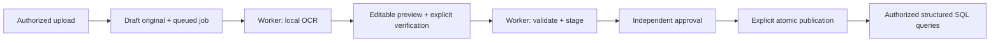

# Phase 6: local OCR, push-to-talk and bounded reads

> Historical phase notes: current setup/schema is **0009**. The mandatory second-reviewer requirement was superseded by scoped explicit same-admin approval in 0009. Original-machine revision/status statements and artifact links below are historical, not the state of a teammate checkout. See [current setup](../README.md), [publication](publication.md), [verification](verification.md) and [limitations](limitations.md).

## Status and boundaries

The implementation preserves Next.js, FastAPI, SQLAlchemy, Supabase JWT and
membership verification, private originals, durable jobs, independent approval,
publication and selected-document retrieval. It does not enable a paid or external
speech/model service. Assets were downloaded only after approval, into ignored
workspace storage; optional speech packages were installed only in this project's
existing `.venv`. No system OCR installer or system language installation is used.

The original development SQLite is already at `0005`, following its separately
approved November 2 migration. The Phase 6 brief's `0004` statement is stale.
Phase 6 needs no new database migration: menu date/meal and OCR review metadata
use the existing validated JSON payloads. This phase's verifier opens the original
read-only, creates a consistent backup, and migrates only disposable copies.
`artifacts/database-verification.json` records the unchanged original hash and
per-table hashes. No Supabase project or unrelated Docker resource is modified.

Local implementation and synthetic evaluation are not complete production
acceptance. Real campus photographs, human Kannada/Hindi/mixed speech, audible
voice quality, HTTPS mobile devices, live Supabase and deployed workers still
need their own acceptance tests. Do not label Phase 6 complete based on mocks.

## Files and responsibilities

| File / function | Change and reason |
| --- | --- |
| `backend/app/ocr.py`: `readiness`, `image`, `recognize`, `menu_rows` | Local Tesseract through installed PyMuPDF, preprocessing, word-box alignment and conservative price-list parsing |
| `backend/app/parsing.py`: `needs_ocr`, `parse_file`, `parse_inline` | JPEG/PNG/WebP, scanned/mixed PDF detection, isolated bounded extraction and page references |
| `backend/app/process_limits.py`: `apply_limits` | Windows Job Object memory limit; POSIX address-space/CPU limits |
| `backend/app/ingestion.py`: `receive`, `preview`, `confirm`, `process`, `work_once`, `queue_capacity` | Durable OCR extraction stage, review gate, revalidation, failures/retries and bounded outstanding jobs |
| `backend/app/files.py`: `Files.change` | Restored/rolled-back scans return to worker extraction and a new review |
| `backend/app/schemas.py`: `ImportOptions`, `MappingRequest`, `MenuData` | Language/diet/location choices, explicit review acknowledgement, optional meal/date |
| `backend/app/speech.py`: `capabilities`, `transcribe`, `infer` | Authenticated adapter's bounded, offline CPU recognition subprocess |
| `backend/app/main.py`: `voice_transcribe`, `voice_capabilities`, `ocr_capabilities`, `request_metadata` | Verified membership, rate limits, in-memory bounded audio and request IDs |
| `backend/app/cache.py`: `SharedCache`, `touch`, session event handlers | Permission-aware optional Redis cache and commit-time revision invalidation |
| `backend/app/services.py`: `records`, `notices`, `menu`, `serialize` | Batch source metadata, cache integration and dated menu filtering |
| `backend/app/db.py`: `make_engine` | Bounded PostgreSQL pool wait and connection recycling |
| `backend/app/ai.py`: `JsonProvider.request` | At most one short transient 429/503 retry, then existing grounded/extractive fallback |
| `frontend/src/lib/speech.ts` | STT/TTS interfaces and local server, on-device browser and local voice implementations |
| `frontend/src/components/voice-controls.tsx`, `chat-view.tsx` | Manual recording, cancellation, transcript review, text fallback, stop/replay and session changes |
| `frontend/src/components/admin-view.tsx`, `frontend/src/lib/api.ts` | OCR options, review, editable rows, warnings, original link and typed preview |
| `frontend/src/app/globals.css` | Wrapping controls and minimum 44-pixel voice buttons |
| `frontend/next.config.ts` | Permit microphone only for the application origin; retain camera/geolocation denial |
| `backend/requirements.txt`, `backend/requirements-speech.txt`, `.env.example` | Pillow/Redis and explicitly optional local speech setup |
| `scripts/setup_local_assets.py`, `evaluate_ocr.py` | Explicit downloads with upstream hashes and reproducible real-image evaluation |
| `scripts/benchmark_phase6.py`, `benchmark_http.py` | Synthetic before/after service and bounded concurrent HTTP evidence |
| `scripts/verify_redis.py`, `verify_frontend.py` | Owned disposable Redis/PG and fresh browser resources; safe cleanup |
| `backend/tests/test_phase6_ocr.py`, `test_speech.py`, `test_cache.py`, `test_ai_providers.py`, `frontend/tests/voice.spec.ts` | Real integrations and explicit denial/failure/provider-contract regression tests |

## Image upload to published SQL records

1. Supabase Auth supplies a signed JWT. FastAPI verifies signature, issuer,
   audience, expiry and subject, then resolves an active database membership.
   A shared menu upload requires the existing department-write administrator
   privilege. A student cannot grant that privilege through upload options.
2. `Ingestion.receive` checks size/type, ownership, checksum and deduplication.
   A quick isolated probe validates raster images or detects scanned PDF content.
   A selectable header above a large scanned body also triggers OCR. Original
   bytes go to the existing private store, under a **draft** source.
3. Scans produce a persistent **queued extraction job**, not published rows.
   The existing separate worker claims it, re-resolves membership, checks source
   state and checksum, and runs local OCR in a bounded subprocess. The API does
   not perform the expensive recognition during upload.
4. Pillow applies EXIF orientation, bounded enlargement, grayscale/autocontrast
   and median filtering. EXIF correction is not arbitrary photo deskew. PyMuPDF's
   integrated Tesseract reads the explicitly installed language data. Recognition
   preserves page numbers and uses word positions to associate adjacent prices.
5. The conservative parser extracts names, numeric prices, headings/category,
   meal and ISO date labels. It recognizes rupee/Rs/INR markers and Unicode digits.
   Ranges, missing prices and conflicting prices remain invalid rather than
   choosing a number. Diet is unknown unless explicitly labelled; an administrator
   must choose a known default or correct each row. Location is also explicit.
6. Extraction saves worker-only staging data and returns the job to **preview**.
   No menu rows are activated. The administrator downloads the original, edits
   extracted JSON/mapping, resolves validation errors and explicitly acknowledges
   verification. Edits reset the acknowledgement unless the new edit is itself
   explicitly reviewed. A confidence percentage is never invented.
7. Confirm queues processing. The worker revalidates every row; invalid records
   block the entire import. Successful shared processing moves the source to
   **pending_review**. A different authorized administrator approves it; a
   currently authorized publisher explicitly publishes it. Publication activates
   records atomically. Existing published replacements remain available until
   that transaction succeeds.
8. Failed extraction stays draft and exposes a safe retry message. Retry queues
   recognition again; it cannot inherit approval. Deletion/revocation cancels
   jobs. Restoration and rollback require fresh extraction/review/publication.
   Re-indexing a published document re-embeds its approved passage text rather
   than silently re-running OCR with different language data.



Files are at most 15 MB; image/raster area at most 20 megapixels; PDFs at most
200 pages with at most 20 OCR pages; output at most 2 million text characters,
10,000 rows and 4 MB row JSON. Each parser has a 30-second parent deadline and
1.5 GiB process memory ceiling; POSIX adds a 25-second CPU limit. Large scans may
hit the deadline before reaching the page cap and must be split. Subprocesses
receive no database or provider credentials. Native-library isolation is not a
filesystem/network security sandbox: production still needs restricted containers,
patched libraries, body/time limits and protected local assets.

The queue limit defaults to 100 outstanding jobs **per tenant/user**, including
extraction and processing. SQLite serializes capacity checks and job claims;
PostgreSQL uses a transaction advisory lock for capacity and `SKIP LOCKED` for
claims. The existing 10-minute stale-claim recovery, source/job lock order,
atomic processing transaction and permission recheck remain in use. OCR finishes
within the shorter parser deadline. Failed jobs need an explicit retry; there is
no infinite retry loop or new external queue.

## Student speech to grounded answer to spoken output

1. Nothing records automatically. Pressing Microphone fetches authenticated
   capabilities and asks browser permission. HTTPS or localhost is required.
2. `LocalServerSpeech` records supported WebM/Ogg in memory, at most 30 seconds
   and 2 MB. Stop releases the microphone before transcription. Cancel, unmount,
   tenant/user/role/department/section/document/language changes discard pending
   capture and responses. Text submission is disabled while recording/transcribing.
3. The raw-body voice endpoint verifies the same JWT and active membership as
   chat. It reads bounded chunks without multipart disk spooling, counts failed
   attempts toward a six-per-minute budget, and rejects excess work. At most two
   recognitions run concurrently **per API process**; excess calls receive 429.
4. A subprocess decodes WAV/WebM/Ogg with PyAV, checks decoded duration and
   rejects silent audio. Approved multilingual Whisper-tiny runs on CPU/int8,
   two threads, from local files with network downloads disabled. A 45-second
   parent deadline and 1.5 GiB memory ceiling contain routine failures. Audio
   exists only in request/process memory; CampusOS creates no audio file.
5. The transcript is shown in the question input for correction. Only pressing
   Send passes that text into the existing authenticated chat router. It uses
   deterministic SQL tools or permission-filtered selected-document retrieval,
   existing citation checks and grounded/extractive fallback. No speech component
   chooses a tenant, document permission or SQL statement.
6. The normal text answer, record cards and citations remain visible. Local
   device TTS can read the answer; Stop and Read aloud support replay. Only a
   voice with `localService=true` and the matching language is selected. Browser
   cloud voices are excluded. Missing voices leave a useful text-only state.

Raw audio is not persisted by CampusOS. **Submitted transcript text is a chat
question**, so normal owner-only conversation persistence still applies. Device,
OS, swap, browser extension and host-operator controls are outside this promise.
Cancelling the browser request suppresses stale results; a server subprocess
already running can finish within its deadline. This is bounded cancellation,
not guaranteed immediate termination of server inference on disconnect.

The prior `Permissions-Policy: microphone=()` header would deny even an approved
microphone. Phase 6 uses `microphone=(self)`, never `*`, and retains camera and
geolocation denial. Browser permission and the manual microphone button are
still required. Test capture uses a fake device and synthetic WAV.

`SpeechInput` and `SpeechOutput` isolate provider choices. Whisper supports
automatic language detection plus explicit English/Hindi/Kannada. The alternate
browser recognizer runs only if `processLocally` and an already-installed local
language pack are available; it never silently enables cloud recognition or
downloads a pack. No approved neural TTS service is configured. Device voices
are a fallback, not a claim of neural or Copilot-quality speech.

English synthetic speech has been recognized by the real local model. Kannada,
Hindi and mixed human speech accuracy, course codes, names and noisy microphones
remain unmeasured. The small model can mistranscribe or hallucinate non-silent
noise; transcript review is necessary. The deterministic multilingual router has
bounded campus vocabulary, not universal translation. Source record values stay
in their original language. The browser/device must have an appropriate local
TTS voice; this Windows machine initially had only English desktop voices.

## Redis and database authorization

Redis is optional and disabled by default. It accelerates shared menu, faculty,
event, notice metadata, timetable and exception reads. Email bodies, private
document passages, conversation text, OAuth tokens and JWTs are not cached.
Private rows cause a cache write to be bypassed.

A hashed key includes tenant, actor, role, department, semester, section, campus
date, query parameters, authorized source fingerprint and a tenant revision.
The database still resolves membership on each request. Each hit rechecks row
IDs/source IDs against the original SQL authorization predicate, including active
and published parent sources and no private owner. A cached foreign ID cannot
grant access. This deliberately retains database reads: Redis is an accelerator,
not a second authority.

Session events collect changed tenants and increment revisions only after the
outer transaction commits. Publication/file security-definer actions explicitly
mark their tenant. Upload, confirmation, worker changes, publication, replacement,
revocation, deletion, restoration, rollback and membership/record edits invalidate
the tenant revision. A savepoint is not a completed transaction. Rolled-back
changes do not publish a revision. The source fingerprint/read-time SQL checks
still prevent withdrawn-source disclosure if Redis is down during invalidation.
Out-of-band in-place data edits require invalidation or the short TTL to expire.

Values expire after 30 seconds (configuration range 1–120). A five-second SET-NX
fill lock avoids duplicate Redis fills without making other callers wait; those
callers can still read SQL. Values are bounded to 1 MB/1,000 rows. Socket/connect
timeouts are 150 ms, the pool has 12 connections and no connection retries.
Redis errors fall back to SQL; deployment Redis should be private, authenticated
and encrypted where the network is not trusted. No shared production cache was
contacted. The verifier requires an ownership marker before using test Redis.

## Performance, streaming and trade-offs

Batch-loading source metadata removed an N+1 query pattern. On the same 30-query
synthetic service benchmark, median SQL statements fell from **29 to 2**, median
latency from **8.787 to 1.827 ms**, and p95 from **9.392 to 4.713 ms**. These are
service-only SQLite measurements, with Redis off. They do not prove Redis speedup
or production capacity. A separate 24-request/four-caller local HTTP measurement
records p50/p95 in `artifacts/performance-http.json`; it uses a fresh API, fake RSA
identities and a disposable database, never the original campus database.

The separate Redis-enabled benchmark had median **14.126 ms**, p95 **19.817 ms**,
and two SQL statements per read. That was slower than batched SQLite on this
small dataset, where hashing/fingerprinting, Redis round trips and mandatory SQL
reauthorization cost more than serializing a few records. Redis therefore stays
disabled by default. Representative larger PostgreSQL workloads need measurement
before expecting a benefit; the benchmark does not establish one.

No index was added without workload evidence. PostgreSQL retains its existing
pool size/overflow and pre-ping, with a five-second pool wait and 30-minute
connection recycle. The existing database-backed request limits and frontend
in-flight locks remain; uploads have a ten-per-minute budget in addition to job
backpressure. Provider 429/503 responses get at most one retry only for a short
numeric Retry-After (at most 250 ms) within the remaining request budget. Long
throttling waits, transport timeouts, invalid JSON and other failures use fallback.
HTTP timeouts bound network operations; this is not a host-level wall-clock kill
of a model request. Live provider requests were not made.

The existing chat endpoint uses SSE for progress and progressive presentation of
an already validated answer. It buffers model JSON until citation/quote checks
succeed, then sends answer text in small deltas. **This is not provider token
streaming and does not reduce time to first generated token.** Rendering unverified
tokens would bypass grounding checks. Browser AbortController cancels pending
chat/audio requests and stale responses are ignored. Request/error logs include
request IDs, method/status/timing and exception type, not JWTs/questions/audio.

## Installation and reproducible local checks

Run from the inner repository root, the directory containing `alembic.ini` and
this project's `.venv`. The outer workspace also has a Python environment; do
not install into it by accident. No commands below install system tools.

For migration readiness, `scripts.verify_databases` checks a fresh consistent
read-only backup, integrity, foreign keys, revision, old-column data preservation
and a disposable upgrade through `0005`. To inspect one of its recorded copies,
use a separate shell and its exact `migration-copy.db` path:

```powershell
$env:DATABASE_URL='sqlite:///C:/ABSOLUTE/PATH/TO/DISPOSABLE/migration-copy.db'
.\.venv\Scripts\python.exe -m alembic current
.\.venv\Scripts\python.exe -m alembic upgrade 0005
```

Do not run these mutation commands against the original file: it is already
`0005`. For any other existing environment, stop its API/workers, verify its URL,
back up consistently and obtain approval before upgrading. `0005` adds defaulted
`sources.file_state` and PostgreSQL lifecycle functions without dropping old
rows. Its downgrade intentionally refuses to discard tombstones. Rollback means
an operator-reviewed backup restore with services stopped, matching object-store
state and an explicit plan for writes since backup; it cannot resurrect purged
objects. No downgrade, restoration or new migration was performed in Phase 6.

```powershell
.\.venv\Scripts\python.exe -c "import sys; print(sys.executable)"
.\.venv\Scripts\python.exe -m pip install -r requirements.txt
# Optional local speech packages and model downloads need operator approval.
.\.venv\Scripts\python.exe -m pip install -r backend/requirements-speech.txt
.\.venv\Scripts\python.exe -m scripts.setup_local_assets --ocr --speech
```

The last command downloads public assets only when absent, verifies installed
assets against upstream hashes, and writes `artifacts/local-assets.json`. It
never receives campus content or credentials. OCR uses `tessdata_fast` 4.1.0
English/Hindi/Kannada; speech uses Systran/faster-whisper-tiny. Small OFL Noto
fonts support the Indic evaluation. No startup hook downloads anything.

On Windows, the approved setup used less than the 250 MB package/model budget.
Linux deployments use the same Python packages/approved assets, Linux wheels
and explicit read-only asset mounts; verify resource limits on the actual host.
Set deployment paths explicitly rather than assuming a Windows development path.

```dotenv
OCR_ENABLED=true
OCR_TESSDATA_PATH=.scratch/tessdata
OCR_LANGUAGES=eng
SPEECH_ENABLED=true
SPEECH_MODEL_PATH=.scratch/whisper-tiny
REDIS_ENABLED=false
CACHE_TTL_SECONDS=30
INGESTION_QUEUE_LIMIT=100
```

API and worker need matching OCR paths and language packs. Existing ignored `.env`
files were not rewritten; an explicit `OCR_ENABLED=false` still overrides the new
default. Startup logs readiness; authenticated administrators can inspect
`GET /v1/admin/ocr`, and members can inspect `GET /v1/voice/capabilities`.
If using Redis, configure its private URL in server secrets and enable it on
both API and worker. Do not put the URL in `NEXT_PUBLIC_*`.

```powershell
.\.venv\Scripts\python.exe -m scripts.evaluate_ocr
.\.venv\Scripts\python.exe -m scripts.verify_databases
# Docker required: creates/removes only its own tmpfs, loopback-only containers.
.\.venv\Scripts\python.exe -m scripts.verify_redis --databases
.\.venv\Scripts\python.exe -m scripts.benchmark_phase6 --label current
.\.venv\Scripts\python.exe -m scripts.benchmark_http
.\.venv\Scripts\python.exe -m ruff check backend scripts
.\.venv\Scripts\python.exe -m scripts.verify_frontend
git diff --check
```

`verify_databases` without `--postgres` verifies the read-only backup/copy and
SQLite migration tests. The combined Redis command also creates its own pgvector
container, migrates it and runs the full backend suite. No existing Docker
volumes are mounted. Generated credentials stay out of reports. Browser verification
chooses unused loopback ports, starts fresh RSA identities/database/worker and
restores `next-env.d.ts`. It uses synthetic fake-device audio, never the operator's
physical microphone. `--browser-only --voice-only --project desktop` narrows a
diagnostic run. A Windows Job Object closes only that verifier's process tree.

## Manual demonstrations and remaining acceptance

1. **Menu:** run API and separate worker against an approved development database;
   sign in as an authorized administrator. Generate fixtures with `evaluate_ocr`;
   choose Menu, language, known diet/location and upload an image from its recorded
   scratch directory. Observe queued extraction, then preview. Download the
   original, correct every name/price, acknowledge review and validate. Confirm;
   verify another administrator must approve, then publish. A student should see
   the new menu only after publication. Try a range price, rejected scan and failed
   worker retry. Do not use institution data for this demo without approval.
2. **Voice:** on localhost/HTTPS press Microphone, allow it, ask a campus question,
   Stop, correct the transcript and Send. Inspect answer/citations. Read aloud,
   Stop and replay. Deny permission to confirm text still works. Change tenant or
   conversation while recording and verify capture is cancelled. Try each language;
   record actual errors and latency rather than assuming quality from model support.
3. **Cache:** run the disposable Redis tests. In a separately approved staging
   setup enable Redis on both API/worker; publish/delete/revoke a test source and
   confirm the next request reauthorizes. Never use a production Redis URL for tests.
4. **Deployment:** no live Supabase Auth login/refresh/key rotation, Storage bucket
   privacy/direct-denial, restricted deployed API login, hosted worker restart or
   actual mobile HTTPS/microphone test is claimed. Those remain approval/credential
   gates. Real neural TTS and a larger speech model would need separate approval,
   quality evaluation and resource/cost review.

## Engineering questions

**Why doesn't accurate OCR directly publish?** OCR recognizes shapes; it cannot
establish a menu's intended price or dietary safety. Validation catches malformed
values, human comparison catches plausible errors, and independent publication
controls prevent one uploader from making shared facts live alone.

**Why retain SQL checks on a Redis hit?** A fast cache can outlive a revoked
membership or source. Fresh membership and SQL source/row checks preserve the
security boundary. The small demo dataset may not benefit from Redis; measure
representative load before enabling it in deployment.

**Why Whisper-tiny instead of a larger model?** It fits the approved local budget
and provides an actual offline recognition path. Its size limits recognition
quality, especially code-switching and names. A provider interface permits a
later approved replacement without changing authorization or chat behavior.

**Why aren't natural voices promised?** Local browser voices depend on the OS and
installed languages. Passing a mocked playback-control test says nothing about
voice quality. Human evaluation and an approved neural voice are separate work.

**Can a crashed worker expose half an import?** The extraction stage only saves a
draft preview. Processing/domain changes commit atomically, publication is a
separate atomic transition, and stale claims can be reclaimed. Hosted operational
behavior still needs staging verification, even though local separate-process
and PostgreSQL concurrency tests pass.

## Evidence

Read `artifacts/phase6-verification.json` and `docs/phase6-verification.md` for
executed results, initial failures, skipped checks and current blockers. Raw
JUnit/browser artifacts are the evidence; counts must be derived from those
files, not manually changed to appear successful.

References: [PyMuPDF integrated OCR](https://pymupdf.readthedocs.io/en/latest/faq/index.html),
[Tesseract language data](https://github.com/tesseract-ocr/tessdata_fast/tree/4.1.0),
[faster-whisper](https://github.com/SYSTRAN/faster-whisper),
[approved tiny model](https://huggingface.co/Systran/faster-whisper-tiny/tree/main),
[browser local recognition](https://developer.mozilla.org/en-US/docs/Web/API/SpeechRecognition/processLocally),
[local speech voices](https://developer.mozilla.org/en-US/docs/Web/API/SpeechSynthesisVoice/localService).
